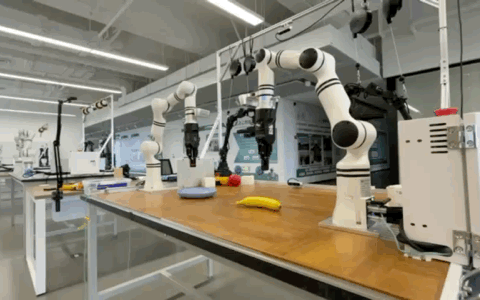

# Astra × RealMan

**Multimodal Reasoning and Closed-Loop Manipulation on a RealMan Dual-Arm Robot**

[English](README.md) · [简体中文](README_CN.md)

Astra × RealMan connects a multimodal decision-making model with a real dual-arm robotic system. The project explores how visual observations, robot state, action planning, and execution feedback work together in physical manipulation tasks.

## Real-robot result: banana pick → handoff → place

On **October 18, 2026**, the RealMan dual-arm system completed a banana pick → handoff → place task in the V17 experiment, with completion confirmed by the onsite operator.

The left arm grasped and lifted the banana, presented it to the right arm, and released it after the right arm established a grasp. The right arm then transported the object, placed it in the target plate, and withdrew. The completed run involved **33 model requests over 1176.332 seconds** (approximately 19 minutes and 36 seconds).

This was one successful real-robot execution rather than a repeatability benchmark. A subsequent V19 attempt did not complete the handoff.

[V17 experiment record](https://github.com/chao142857/astra-realman/blob/realman/v17/astra_realman_harness/docs/V17_SUCCESS_SNAPSHOT_20261018.md) · [V17 / V19 analysis](https://github.com/chao142857/astra-realman/blob/realman/v17/astra_realman_harness/docs/banana_v17_v19_light_20261018/README.md)

**V17 successful banana pick → handoff → place (3× playback).** [Original-speed video](https://chao142857.github.io/assets/video/realman.mp4). [Media source](assets/README.md).

## How the manipulation loop works

**Multi-view observations and robot state → Multimodal decision model → Structured action proposals → Robot-side validation and execution → Updated observations and feedback**

The model receives visual observations, robot state, task instructions, and bounded decision history. It proposes arm motions and gripper actions. The execution interface validates proposals, performs inverse-kinematics and motion checks, and sends accepted commands through the robot SDK. Measured state, gripper feedback, and execution results inform the next decision.

The implementation includes coordinated dual-arm grasping, handoff and release; GUI-based operation; simulation interfaces; run logging; and diagnostic analysis.

## Related experiments

- **Spatial grounding:** Compared multi-view RGB, estimated 3D geometry, and oracle geometry for spatial decisions, exposing missing-geometry and collision-reasoning failures.
- **Dual-arm simulation:** Developed RM65 simulation interfaces, grasp/release behavior, sequential action execution, and contact diagnostics. This track did not establish a completed model-driven handoff task.
- **Persistent World and action history:** Explored object state, geometry, history, and feedback across decisions. Limited comparisons exposed consistency and execution failures.
- **ASPIRE integration:** Investigated SAM3 perception, 3D geometry, and GPU motion planning through offline and synthetic execution tests.

These research lines preserve distinct implementations; they were not all integrated into or validated by the V17 run. [Experiment results, failures, and evidence](docs/experiments.md).

## Code and reproduction

| Branch | Entry point |
| --- | --- |
| [`main`](https://github.com/chao142857/astra-realman/tree/main) | Project overview and original RealMan harness baseline |
| [`realman/v17`](https://github.com/chao142857/astra-realman/tree/realman/v17) | Real-robot GUI, dual-arm execution, V17 / V19 records |
| [`research/spatial`](https://github.com/chao142857/astra-realman/tree/research/spatial) | Spatial A/B/C inputs, geometry estimation, evaluation |
| [`research/rm65`](https://github.com/chao142857/astra-realman/tree/research/rm65) | RM65 simulation and action execution experiments |
| [`develop/aspire`](https://github.com/chao142857/astra-realman/tree/develop/aspire) | ASPIRE Phase 0–2B perception and planning integration |

Start with the relevant branch and the [reproduction guide](docs/reproduction.md), which separates ordinary-computer checks, simulation/external assets, and laboratory hardware. Full physical reproduction requires RealMan hardware, calibrated assets, external model access, and the laboratory execution environment. The original V17 run data and media archive are retained separately from the public source repository.

The experiments use external technologies including Astra, RealMan hardware and SDKs, SAM3, cuRobo, and ASPIRE. See [third-party and licensing notes](docs/third-party.md). The [previous overview](docs/archive/README_20261022.md) remains available as a historical document.

Experimental work: October 2026.
