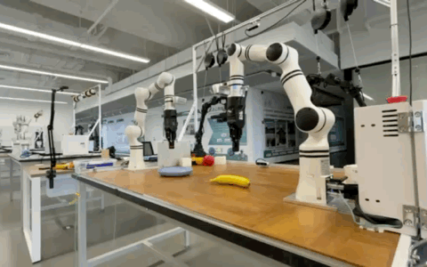

# Astra × RealMan

**RealMan 双臂机器人的多模态推理与闭环操作**

[English](README.md) · [简体中文](README_CN.md)

Astra × RealMan 将多模态决策模型连接到真实双臂机器人，探索视觉观测、机器人状态、动作规划与执行反馈如何共同支持物理操作任务。

## 真机结果：香蕉抓取 → 交接 → 放置

**2026 年 10 月 18 日**，RealMan 双臂系统在 V17 实验中完成了一次香蕉抓取、交接与放置，任务完成由现场操作者确认。

左臂抓取并提起香蕉，将其呈递给右臂，在右臂建立抓握后释放。随后右臂搬运香蕉，将其放入目标盘并撤离。该回合共 **33 次模型请求，耗时 1176.332 秒**（约 19 分 36 秒）。

这是一次成功的真机执行，不是重复成功率基准。后续 V19 尝试未完成交接。

[V17 实验记录](https://github.com/chao142857/astra-realman/blob/realman/v17/astra_realman_harness/docs/V17_SUCCESS_SNAPSHOT_20261018.md) · [V17 / V19 分析](https://github.com/chao142857/astra-realman/blob/realman/v17/astra_realman_harness/docs/banana_v17_v19_light_20261018/README.md)

**V17 香蕉抓取 → 交接 → 放置成功记录（3 倍速）。** [原速视频](https://chao142857.github.io/assets/video/realman.mp4)。[素材来源](assets/README.md)。

## 操作闭环如何工作

**多视角观测与机器人状态 → 多模态决策模型 → 结构化动作提案 → 机器人侧校验与执行 → 新观测与反馈**

模型接收视觉观测、机器人状态、任务指令及有限长度的决策历史，提出机械臂运动和夹爪动作。执行接口校验提案、进行逆运动学与运动检查，再通过机器人 SDK 发送获准执行的指令。实测状态、夹爪反馈和执行结果进入下一次决策。

实现包含双臂协调抓取、交接与释放，以及 GUI 操作、仿真接口、运行记录和诊断分析工具。

## 相关实验

- **空间定位与推理：** 比较多视角 RGB、估计三维几何和 oracle 几何输入，揭示几何缺失及碰撞相关推理的失败。
- **双臂仿真：** 开发 RM65 仿真接口、抓取与释放、顺序动作执行及接触诊断；该研究线未完成完整的模型驱动交接任务。
- **Persistent World 与动作历史：** 探索跨决策的物体状态、几何、历史与反馈维护；有限对照暴露了一致性和执行失败。
- **ASPIRE 集成：** 通过离线及合成执行测试研究 SAM3 感知、三维几何和 GPU 运动规划。

这些研究线保留各自实现，并非全部集成进 V17 或通过该回合获得真机验证。[实验结果、失败与证据](docs/experiments.md)。

## 源码与复现

| 分支 | 入口 |
| --- | --- |
| [`main`](https://github.com/chao142857/astra-realman/tree/main) | 项目概览与原始 RealMan harness 基线 |
| [`realman/v17`](https://github.com/chao142857/astra-realman/tree/realman/v17) | 真机 GUI、双臂执行与 V17 / V19 记录 |
| [`research/spatial`](https://github.com/chao142857/astra-realman/tree/research/spatial) | 空间 A/B/C 输入、几何估计与评测 |
| [`research/rm65`](https://github.com/chao142857/astra-realman/tree/research/rm65) | RM65 仿真与动作执行实验 |
| [`develop/aspire`](https://github.com/chao142857/astra-realman/tree/develop/aspire) | ASPIRE Phase 0–2B 感知与规划集成 |

从对应分支及[复现说明](docs/reproduction.md)开始；说明区分普通计算机检查、仿真或外部资产、实验室硬件三类条件。完整复现物理实验需要 RealMan 硬件、标定资产、外部模型访问和实验室执行环境。V17 原始运行数据与媒体归档独立于公开源码仓库保存。

实验使用 Astra、RealMan 硬件与 SDK、SAM3、cuRobo、ASPIRE 等外部技术，详见[第三方与许可说明](docs/third-party.md)。[旧版概览](docs/archive/README_CN_20261022.md)作为历史文档保留。

实验工作时间：2026 年 10 月。
