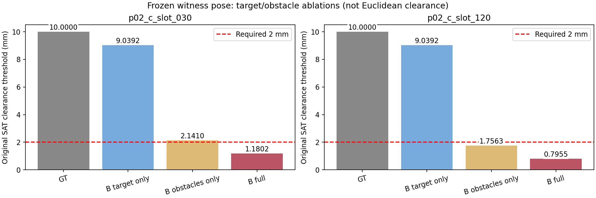
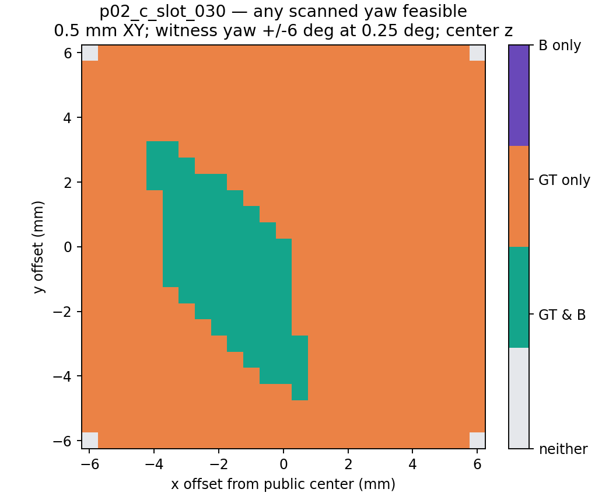
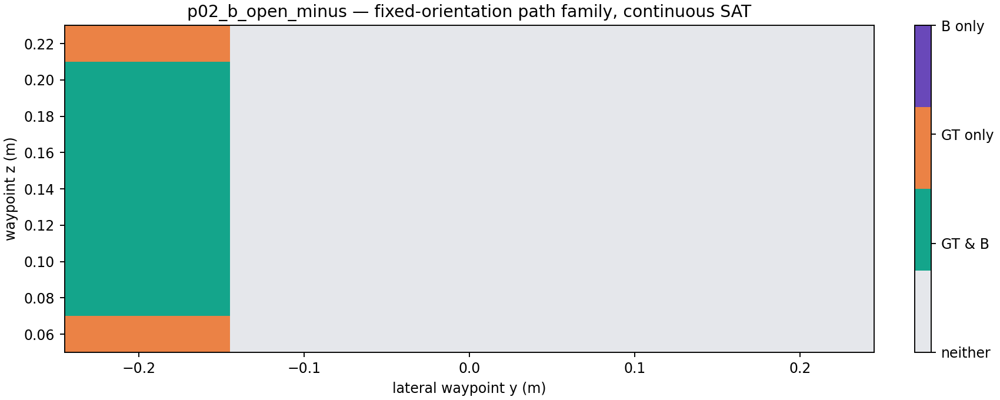
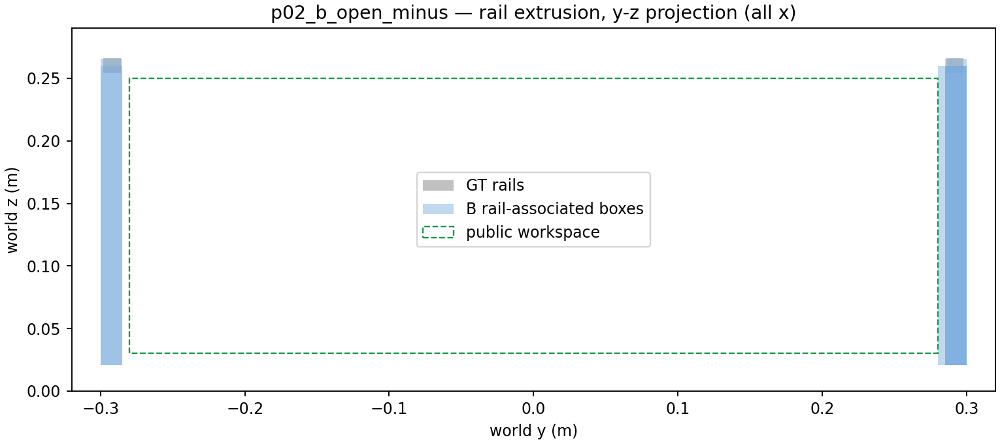

# B v1 任务相关几何审查（2026-10-14）

基线 `2dea56e`。新增 Astra 生成请求 **0**，未连接 Mac Bridge、未创建授权 ledger；B v1、原评分、所有历史结果及原 36 次 A/B/C 计划保持只读。

**结论：不能将 B v1 整体称作“基本保留任务可行性的少量噪声”。** 两个绕障任务保留了全部已归档可行路径；两个窄槽自主 yaw 任务的局部几何误差则足以将所有既有 GT 合法候选拒绝。30° 场景仍有可行位姿，但采样可行域显著缩小；120° 场景在本轮范围内未找到可行位姿，**没有证明全局不可行**。

## 计算边界与数据隔离

直接调用原 `pilot02_contract.score()`，由其复用 `spatial_eval.geometry.contains()` 与 `swept_collision()`；不复制碰撞算法。净空阈值复用 `replay_pilot01.sat_threshold()`，在原连续 SAT 函数上二分首个碰撞阈值，保留非碰撞下界/碰撞上界和 `collision_at_zero`。这是 SAT 投影膨胀阈值，**不是精确欧氏间距**，也不是任务可行性的唯一条件。

四个检查环境分别为 GT、仅替换 B 目标盒、仅替换 B 障碍盒、完整 B。两个混合环境仅作显式标记的误差归因，不是 B 模型输入。

完整 B 环境的构造函数只接受公共 A context 与冻结 B geometry；目标盒和障碍盒全部来自 B，目标区域/工作空间从公共 task 文本严格解析，缺失即报错，绝不回退至 GT。保存的 `B_check_environment.json` 可核查来源；其中 `ground_truth` 字段只是复用原评分接口的容器名，内容仍为 B 几何。私有 witness 和真实模型输出作为独立候选动作传入，不加入几何。

候选覆盖每场景原 GT witness、全部 alternate witnesses、全部预声明负对照，以及续测归档的真实 A/C 输出。原始 8 份模型输出在 GT 下的重评分与原 assessment **逐字段一致**，没有更改历史评分或标签。

## 既有候选的对照

| 场景 | GT 合法候选 | GT 与 B 都合法 | GT 合法但 B 拒绝 | GT 非法但 B 接受 |
|---|---:|---:|---:|---:|
| open_minus | 4 | 4/4 | 0/4 | 0/2 |
| open_plus | 4 | 4/4 | 0/4 | 0/2 |
| slot_030 | 7 | 0/7 | 7/7 | 0/2 |
| slot_120 | 7 | 0/7 | 7/7 | 0/2 |
| 按候选标签合计 | 22 | 8/22（36.36%） | 14/22（63.64%） | 0/8 |

候选存在重复动作、四元数符号等价和 180° 盒对称，表中是带来源标签的检查计数，不是独立抽样成功率。四份真实绕障 A/C 输出全部通过 B；四份真实 yaw A/C 输出全部被 B 拒绝。负对照数量很小，0 次错误接受不构成 B 保守性或安全性保证。

## 自主 yaw：用户提出的现象得到独立复核

固定原 GT witness 的位置与朝向，仅替换几何；仍使用原 2 mm 阈值。

| 场景 | GT 阈值 mm | 仅 B 目标盒 mm | 仅 B 障碍盒 mm | 完整 B mm | 完整 B：0 / 2 mm |
|---|---:|---:|---:|---:|---|
| 30° | 9.999970 | 9.039184 | 2.141015 | **1.180222** | 通过 / 拒绝 |
| 120° | 9.999982 | 9.039188 | 1.756258 | **0.795464** | 通过 / 拒绝 |

30° 的限制障碍为 `observed_obstacle_004`，120° 为 `observed_obstacle_007`。30° 中仅障碍误差尚留下约 0.141 mm 的任务余量，叠加目标尺寸误差后越过失败边界；120° 仅障碍误差已足够失败，目标误差进一步恶化。

B 目标短边为 46.921588 mm，而 GT 约 45 mm，半宽多约 **0.960793 mm**，与两组“仅 B 障碍”到“完整 B”的阈值下降吻合。此评分接口会用候选位置和四元数覆盖初始目标位姿，路径起点也来自公共约束；因此初始目标中心误差小，本身不能说明放置可行性保真。



0 mm 检查只是独立附加诊断，没有覆盖原 2 mm 评分；没有将“零净空可放入”当作任务成功。

## 采样可行空间：范围、步长与条件分母

初轮扫描配置先保存于 `predeclared_scan.json`，逐候选输出为 JSONL。自主 yaw 在 [0°,180°) 扫描，利用 upright 长方体的 180° 占据对称；没有覆盖允许的微小倾斜自由度。

| 扫描 | 范围与步长 | 每 yaw 场景样本 | 30°：B 保留 / GT 可行 | 120°：B 保留 / GT 可行 |
|---|---|---:|---:|---:|
| 全公开区域粗扫 | x/y 20 mm、z 40 mm；yaw 10° | 20,250 | 0/3 | 0/3 |
| 中心局部扫描 | x/y 中心 ±12 mm、2 mm；中心 z；yaw 2° | 15,210 | 7/199（3.52%） | 0/199 |
| 后续探索性细扫 | x/y 中心 ±6 mm、0.5 mm；中心 z；witness yaw ±6°、0.25° | 30,625 | 872/19,613（4.45%） | 0/19,613 |

细扫是看到初轮结果后预先声明的**探索性补充**，配置另存 `exploratory_followup/exploratory_plan.json`，不是初轮预注册，更不是修改未来 36 次模型实验。使用 GT witness 朝向作为诊断窗口中心，不能作为未见测试。各扫描重叠，不合并成独立样本总体。

细扫中 GT 非法样本各为 11,012，B 错误接受均为 0；GT 可行但 B 拒绝为 30° 的 18,741/19,613（95.55%），120° 的 19,613/19,613。总体 agreement 会被大量双重不可行样本抬高，不能取代上述条件指标。

30° 已找到可复核的存在证书：位置 `[0.636, 0.042, 0.12]` m，yaw **29.25°**，GT 和 B 原评分均通过。B 阈值约 **2.028657 mm**。这是首个找到的样本，不是最大余量或最优位置。120° 的粗扫和两层细扫均未找到 B 可行样本；未扫连续位置/全部微倾斜，**不能将“未找到”升级为全局不可行定理**。



图对各 x/y 汇总“至少一个扫描 yaw 可行”，并非所有 yaw 均可行；原始逐姿态对照保留。

## 固定姿态绕障：碰撞与区域约束必须分开

每场景扫描 441 条三段路径：横向 waypoint y 为 −0.24…0.24 m（10 mm），z 为 0.06…0.22 m（20 mm），两侧 x 取公共起点和目标中心 x，最后回到公共目标中心。全程固定原四元数，所有线段使用原连续碰撞检查，未用离散 waypoint 无碰撞冒充连续路径合法。

- **连续碰撞判定一致率 441/441**：90 条均无碰撞，351 条均有碰撞。
- 完整任务合法性：GT 90 条，B 70 条；保留 70/90（77.78%），误拒 20/90（22.22%），错误接受 0/351。
- 20 条误拒均位于 z=0.06 或 0.22 m，失败约束只有 `path_in_workspace`；“仅 B 目标盒”复现，“仅 B 障碍盒”通过。
- B 目标高度 60.611113 mm，GT 约 60 mm，使贴近上下边界的目标各越界约 **0.305557 mm**；这不是横杆碰撞造成的拒绝。
- 原 witness、alternate 和真实 A/C 路径均通过。其连续 SAT 阈值在 GT 下约 50–90 mm、B 下约 24.10–54.10 mm，仍远大于 2 mm。逐路径、逐障碍阈值均在 `candidate_comparison.json`。



## 悬空横杆：错误体积的位置比总体 precision 更重要

冻结估计器用全部中性灰高处点的**全局最低 z**作为每个顶面 footprint 的挤出底面，因而把悬空横杆向下填成墙。是跨构件共享高度范围的建模错误，不是观测证明其下方存在实体。

多数横杆相关 B 盒位于公共 workspace 的 y=±0.28 m 之外，0 和 2 mm workspace 相交检查均不相交；少数网格碎片接触边界或其膨胀带。不能从占据体积 precision 约 44% 直接推断主要通路被截断。

额外边界探针每场景 3,960 个同时满足 GT/B 完整目标盒 workspace 包含的位姿；x 步长 5 mm，y 距共同可容纳边界内缩 0/1/2/5/10 mm，z 取共同可容纳下界/中心/上界。横杆关联由评测端根据 GT 位置作诊断标注，未反馈 B。

- 两场景各有 3,555 个 GT 无碰撞探针。
- minus 场景其中 9 个与 B 横杆相关盒碰撞，plus 为 0。
- 移除横杆相关盒的评测消融显示：**两场景独由横杆导致的额外拒绝均为 0**；minus 的这 9 个也已被其他 B 障碍拒绝。

因此存在局部边界影响，但在本轮路径族和探针范围内，没有证据表明横杆假墙独立封死可通行空间。不能将有限探针外推到所有路径。



## B v2 建议：仅方案，本轮不开发或回写

1. **局部三维连通与高度支持**：按观测 3D 连通分量/局部面与深度不连续拆分构件；为每个构件建立局部 z 支持，不将某块竖直挡板的底面用作悬空横杆底面。结合多视角侧面/底面证据；无法观测的区间标记未知，不默认填实或为空。
2. **观测射线的空空间约束**：只用实际 RGB-D 射线检查候选实体是否侵入已观测自由空间；区分已占据、已观测自由、未知，避免用体积挤出伪造遮挡后形状。
3. **临界边界与不确定性**：5 mm 网格和闭运算没有足以保证 2 mm clearance 的误差界。改用观测支持的边界/平面拟合、局部细化，并记录像素足迹、深度/标定误差、视角一致性、分割边缘不确定性。更细网格不能凭空提高传感器精度；对无法确定的窄隙报告区间，不能用 GT 调整到恰好通过。
4. **任务相关验收**：同时看 GT 可行解保留率、错误接受率、连续路径一致性、贴边区域约束和可行域收缩，分开报告尺寸/位置/高度误差。采用原评分，不能放宽 2 mm 阈值来“修复”重建。
5. **版本与独立验证**：若实施 v2，明确标记其设计已经受 v1 的 GT 诊断启发；旧四场景是开发诊断集，不再声称完全未见。先在独立生成、预先冻结的悬空构件、旋转/平移槽、不同观测遮挡及临界间隙场景上验证；构建与估计过程不接触这些场景的 GT。任何 schema/不确定性表达扩展单独版本化。

原 36 次 A/B/C 计划本轮没有改动。就现有证据，若未来直接测 B v1，必须把“输入几何造成的可行域损失”与模型规划能力区分；不能仅因模型在 B 下失败就解释为 Astra 空间规划差。

## 执行、验收与复现

初轮在 ubuntu-robot 完成。随后 SSH 返回 `Connection closed ... port 22`；本地使用同一冻结代码/数据完整复现初轮计数与阈值，并完成探索性扫描、绘图和测试。最终归档以本地重跑为准；没有尝试修改 SSH/bridge 或连接机器人。科学绘图依赖仅安装在独立 `.audit-plot-venv`，不修改已有环境。

**25 项测试通过**（新增 8 项 + 原 Pilot02 17 项），覆盖原函数复用、公共 B 环境构造、缺少公共区域拒绝、yaw 阈值/0 与 2 mm 对照、8 份原评分逐字段一致、可行证书、绕障高度误拒归因和指标分母。3,577 个 B 原型及历史运行文件在审查前后 SHA 不变；原 36 次计划包含在保护集合内。

证据根目录：`experiments/spatial_input_eval_v0/evidence/b_task_audit_20261014`。所有扫描保留逐样本 JSONL，候选保留四种几何、0/2 mm 结果、约束失败和逐障碍 SAT 阈值。可视化均明确为诊断，不是新仿真图像或模型输入。

在本地审查 worktree 或具有同一提交的 Linux checkout，使用新的输出目录：

```bash
MOD=experiments/spatial_input_eval_v0
export PYTHONPATH="$MOD:$MOD/lab"
python3 "$MOD/lab/b_task_audit/audit.py" --module "$MOD" --output /tmp/b-task-audit-new
python3 "$MOD/lab/b_task_audit/followup.py" --module "$MOD" --audit /tmp/b-task-audit-new --output /tmp/b-task-audit-new/exploratory_followup
# 绘图需 Matplotlib/NumPy；不参与碰撞或评分计算。
python3 "$MOD/lab/b_task_audit/figures.py" --module "$MOD" --audit /tmp/b-task-audit-new
PYTHONPATH="$PYTHONPATH:$MOD/tests" python3 -m unittest test_b_task_audit test_pilot02
```
