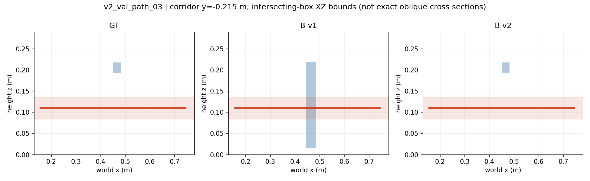
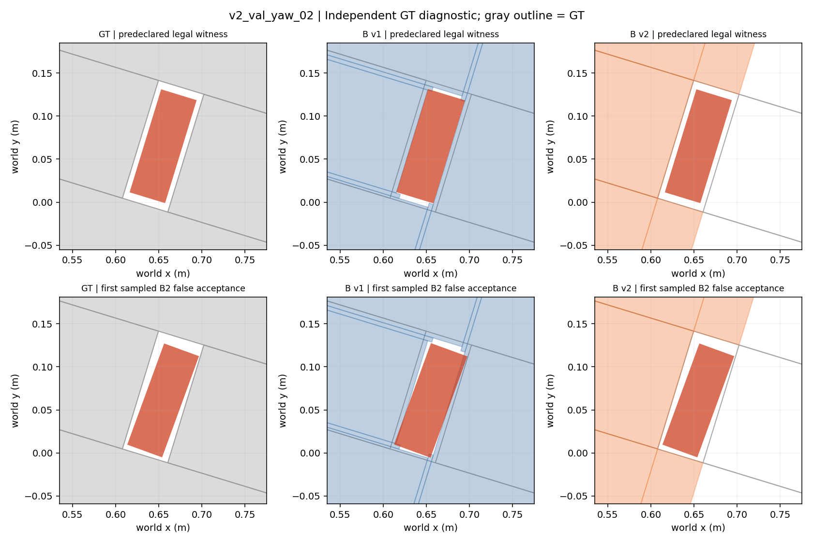

# B v2 任务可靠几何原型评测

结论：值得继续投入局部高度与连续边界估计，但当前 B v2 仍不能作为完整、可靠的碰撞环境。独立六场景中，合法路径保留由 20/214 提升到 206/214；合法 yaw 采样姿态由 0/58 提升到 58/58。但 yaw 条件下有 182 个非法姿态被错误接受，来自障碍漏检。只看保留率、已有 witness 或占据 precision 会夸大改进。

本轮真实 Astra 请求为 **0**，未连接 Mac Bridge，未创建授权 ledger。研究基线为 `3008a8a`。旧四场景仅作开发诊断，B v2 设计已受它们的 GT 审查启发。旧冻结 36 次计划、评分和全部历史结果不变。

## 独立验证与信息隔离

六个新场景包含三种有限高度绕障配置（含独立悬空横杆与连接立柱的横杆），以及 17°、73°、137° 三个新窄槽。横向每侧余量分别为 3.5、6、10 mm；长轴每侧 9 mm。角度与这些规格只供私有设计/评测，不作为正确姿态传给估计器或 A/B 输入。相同三视角下导出真实 SAPIEN RGB-D、标定与独立 GT，全部保留，未根据结果替换场景。

`pre_estimation_lock.json` 在验证集生成前锁定 B v1/B v2 与场景生成源码。公共导出仅包括 A 上下文、RGB、depth_m 和 valid；不读 segmentation，估计隔离审计阻止私有仓库、网络和子进程。两版估计及开发诊断结果在 `estimates_sealed.json` 绑定并作阶段提交后，才执行独立 GT 评测。`scan_predeclaration.json` 先声明采样范围。封存与最终 hash 复验均保留。

场景仍共享渲染器、红/灰材质、相机与 upright box 先验，因此只是独立几何配置验证，不支持跨材质、真实深度噪声或复杂曲面泛化结论。表面 RGB 是真实渲染，图示与线框另列为诊断。

## 任务可行域

复用原 `pilot02_contract.score()`、`spatial_eval.geometry.contains()`、`swept_collision()`，固定 2 mm SAT clearance；没有新碰撞算法或阈值修正。路径采样为 y=-0.26…0.26 m、10 mm 步长，z=0.06…0.24 m、20 mm 步长，共 530 条/场景；每条采用两个横向中间点及公共目标中心、固定姿态。yaw 采样以公共区域中心为基准，xy 各 ±12 mm、4 mm 步长，z 固定公共中心，yaw=0…178°、2° 步长，共 4410 个/场景。有限格点不证明全局可行或不可行，yaw_01 仅有两个合法格点，分母尤其有限。

| 场景 | GT 合法数 | B v1 保留 | B v2 保留 | B v1 错误接受/GT 非法 | B v2 错误接受/GT 非法 |
|---|---:|---:|---:|---:|---:|
| v2_val_path_01 | 74 | 10 | 70 | 0/456 | 0/456 |
| v2_val_path_02 | 74 | 10 | 70 | 0/456 | 0/456 |
| v2_val_path_03 | 66 | 0 | 66 | 0/464 | 0/464 |
| v2_val_yaw_01 | 2 | 0 | 2 | 0/4408 | 0/4408 |
| v2_val_yaw_02 | 12 | 0 | 12 | 0/4398 | 98/4398 |
| v2_val_yaw_03 | 44 | 0 | 44 | 0/4366 | 84/4366 |

路径合法保留率为 **9.35% → 96.26%**，两版均未错误接受这组 1376 条非法路径；连续路径碰撞判定一致率为 **87.80% → 99.50%**。8 条剩余 B v2 错拒来自障碍估计，不是目标盒：评测端替换为 GT 障碍后均恢复合法。不能把有限采样零错误接受当作全路径保证。

yaw 合法保留率为 **0% → 100%**；B v2 在 13172 个非法候选中误接受 182 个（**1.38%**）。但它共接受 240 个候选，其中只有 58 个真实合法，接受精确率仅 **24.17%**。类别极不平衡，只展示 98% 左右总体一致率会掩盖问题。182 个错误在评测端保留 GT 目标、只使用 B 障碍时全部重现；使用 B 目标和 GT 障碍则全部被拒绝。归因数据在 `evaluation/error_attribution.json`，这些混合世界从未成为 B 输入。

所有六个预声明 witness 均经 GT 验证合法，所有负对照均被 GT 拒绝。B v2 接受全部 witness/alternate 并拒绝全部预声明负对照，但格点扫描仍找到 182 个反例，表明正负对照通过不能代替可行域审查。旧四场景开发对照中，B v2 保留全部 14 个合法 witness/alternate，并拒绝 8 个负对照；这些只是开发诊断，未计入独立统计，也没有重跑历史模型请求。

连接横杆场景中，B v1 将横杆向下挤出，阻塞实际可通行通道；B v2 保留局部高度。图为穿过通道的盒 XZ 包络投影，非斜盒精确截面；红带显示持物体高度范围。

73° 场景一侧障碍体积大量遗漏，导致目标向该侧侵入仍被 B v2 判为合法。137° 场景主要保留两侧墙，遗漏端部约束。二者不能由更准确的已检测平面补偿。所有首个采样反例按固定扫描顺序选择，未修正动作。

## 几何与运行成本

位置为中心向量 L2，尺寸为排序后尺寸向量 L2（允许盒轴重标），高度为标量绝对误差，单位 mm。不能将它们混成一个“精度”。障碍占据以 10 mm 网格采样，排除未重建桌面，不是 2 mm 净空认证。

| 场景/版本 | 位置 L2 mm | 尺寸 L2 mm | 高度 mm | 占据 precision | 占据 recall | 几何构建秒 | 总盒数 | context 字节 |
|---|---:|---:|---:|---:|---:|---:|---:|---:|
| v2_val_path_01/B1 | 0.503 | 1.982 | 0.543 | 0.599 | 1.000 | 0.481 | 14 | 11868 |
| v2_val_path_01/B2 | 0.939 | 1.879 | 1.879 | 0.999 | 0.976 | 0.576 | 3 | 7875 |
| v2_val_path_02/B1 | 0.489 | 1.955 | 0.533 | 0.599 | 1.000 | 0.447 | 15 | 12261 |
| v2_val_path_02/B2 | 0.895 | 1.790 | 1.790 | 0.999 | 0.971 | 0.554 | 3 | 7870 |
| v2_val_path_03/B1 | 0.494 | 1.959 | 0.539 | 0.583 | 0.996 | 0.454 | 13 | 11459 |
| v2_val_path_03/B2 | 0.917 | 1.834 | 1.834 | 0.979 | 0.971 | 0.567 | 8 | 10010 |
| v2_val_yaw_01/B1 | 0.554 | 2.126 | 0.838 | 0.963 | 1.000 | 0.570 | 36 | 21396 |
| v2_val_yaw_01/B2 | 0.951 | 1.903 | 1.903 | 0.999 | 1.000 | 0.654 | 9 | 10219 |
| v2_val_yaw_02/B1 | 0.554 | 2.126 | 0.838 | 0.967 | 1.000 | 0.580 | 9 | 10148 |
| v2_val_yaw_02/B2 | 0.951 | 1.903 | 1.903 | 0.999 | 0.543 | 0.622 | 6 | 8929 |
| v2_val_yaw_03/B1 | 0.554 | 2.126 | 0.838 | 0.962 | 0.947 | 0.578 | 29 | 18713 |
| v2_val_yaw_03/B2 | 0.951 | 1.903 | 1.903 | 1.000 | 0.850 | 0.605 | 3 | 7646 |

B v2 平均构建耗时 0.596 s，B v1 为 0.518 s，来自同一 Ubuntu 工作站单次实测，包含本地观测读取，不是稳定性能基准。B v2 输入准备约 0.7–0.9 ms；B v1 为约 14–17 ms，但额外包含预览，因此不能直接比较该阶段速度。几何与 JSON 字节计数不包含相同的三张 RGB，也不等于模型 token。逐场景 `timing.json` 保存原始值。

B v2 目标中心误差均值反而由 0.524 mm 增至 0.934 mm；高度误差由 0.688 mm 增至 1.869 mm。原因与可见底部截断及边界腐蚀相符，不能称为所有几何指标全面改善。障碍占据 precision 接近 1，但 yaw_02 的 recall 仅 0.543、yaw_03 为 0.850，正好说明高 precision 无法代表完整可用的规划环境。

## 关键边界与可靠性

B v2 连续平面保存 support 数、95% 残差、每视角 median、跨视角差异与 uncertainty proxy。4 mm 连通网格只用于分组；1 mm plane gap 用于平面分组，都不作为测量精度。边界靠近 2 mm 净空时按单视角/缺失面/代理误差规则标记不足，原 clearance 未变。

独立的最近平行 GT 面关联显示，已拟合面的偏移很小，但这只评价“检测到的面”，不包含漏面；同向平面关联可能有歧义，并未验证有限面重叠。不能据此声称全部任务边界有亚毫米保证。尤其 yaw_03 缺失端面，而留下侧面的拟合误差仍很小。

| 场景 | 已拟合面数 | 面偏移中位 mm | 最大 mm | 支持不足面数 |
|---|---:|---:|---:|---:|
| v2_val_path_01 | 15 | 0.0018 | 0.0465 | 10 |
| v2_val_path_02 | 15 | 0.0025 | 0.1153 | 10 |
| v2_val_path_03 | 16 | 0.0012 | 0.0078 | 12 |
| v2_val_yaw_01 | 14 | 0.0033 | 0.0188 | 9 |
| v2_val_yaw_02 | 13 | 0.0053 | 0.0234 | 8 |
| v2_val_yaw_03 | 11 | 0.0008 | 0.0059 | 6 |

所有完整固体都标记可靠性不足，主要因为不可见底面、单视角或缺失支持。该标记有助于避免把几何盒当作确定事实，但本轮没有模型推理，无法判断模型是否会正确使用它。现行 box-only scorer 不读可靠性旁路记录，故这里报告的是原始几何假设的可行性。

GT witness 的 SAT 投影净空如下；SAT 阈值不是精确欧氏距离。B v1 在前两项已经零净空碰撞；B v2 第三项阈值超过 GT，不是更安全，而是遗漏限制端面的表现。

| 自主 yaw 场景 | GT mm | B v1 mm | B v2 mm |
|---|---:|---:|---:|
| yaw_01 | 3.500 | 零净空已碰撞 | 3.472 |
| yaw_02 | 6.000 | 零净空已碰撞 | 5.974 |
| yaw_03 | 9.000 | 1.952 | 9.985 |

已观测表面、深度射线前自由空间和遮挡未知区域有独立语义；盒内部来自 upright-solid 先验，不冒充直接观测实体。不用 GT 补底，也不把缺盒区域宣称为自由。但目前缺少完整的未知区域空间覆盖图；部分无足够顶面支持的格子被略过，`missing: []` 不能证明完整性。这个缺陷应作为下一版重点，而不是用 GT 回填当前 B v2。

## 决策与下一步

建议继续有限投入 B v2：局部高度建模在三个独立通道上有直接任务收益；连续窄槽边界能保留全部测试合法姿态。下一版优先解决可见但漏建的墙体，以及无法观测的区域如何显式表达为未知，避免先做更多整体 IoU 优化。

应只从公共 RGB-D 计算“未被几何解释的观测表面”覆盖图，对每个任务关键边界分别记录存在、支持不足或未知；局部侧面无支持时保留未知边界而非默认为空。再在新的独立场景验证，同时检验保留率和接受精确率。不得使用本次 GT 数值调到刚好过 2 mm。已封存 B v2 不改写。

下一轮模型对照方案见 `future_model_comparison.json`：保留全部六场景，A/B1/B2/C 各一次，共 24 次新客户端请求的最小筛查；可选完整重复至 48 次。另设完全相同 B v2 几何、只增加公共可靠性说明的独立条件，才可估计“表达可靠性”的增益。这里仅提案，尚未冻结或授权，不创建 ledger，也不改旧 36 次计划。场景已做 GT 诊断，因此未来模型研究是机制探索，不再声称这些是完全未见的几何开发测试集。

## 验收与材料

136 项离线测试通过（包含历史测试和 6 项 B v2 测试）。完整日志包含模拟 dispatcher 输出，不代表真实派发。所有估计源锁、公共文件、封存几何与历史文件保护由 `integrity.json` 核验。六场景全部 witness/负对照通过 GT 有效性检查；任务扫描计 14820 个候选，每个在 GT/B1/B2 下独立评分。原始逐候选结果、边界诊断、几何误差、耗时和错误归因均已归档。

- `validation_suite/`：原始三视角 RGB-D、标定、私有 GT、A/C 输入与冻结清单。
- `public_validation/`：估计器允许读取的公共数据。
- `validation_B1/`、`validation_B2/`：封存输入、几何、耗时、隔离记录。
- `development_B2/`：旧四场景开发诊断，单列。
- `evaluation/`：GT 评测及逐候选结果，绝不能进入模型输入。
- `preview_B1/`、`preview_B2/`：原图几何投影；`figures/` 为独立诊断图。
- [启动与复现命令](../../lab/b_v2/README.md)。所有复现输出使用新目录。
