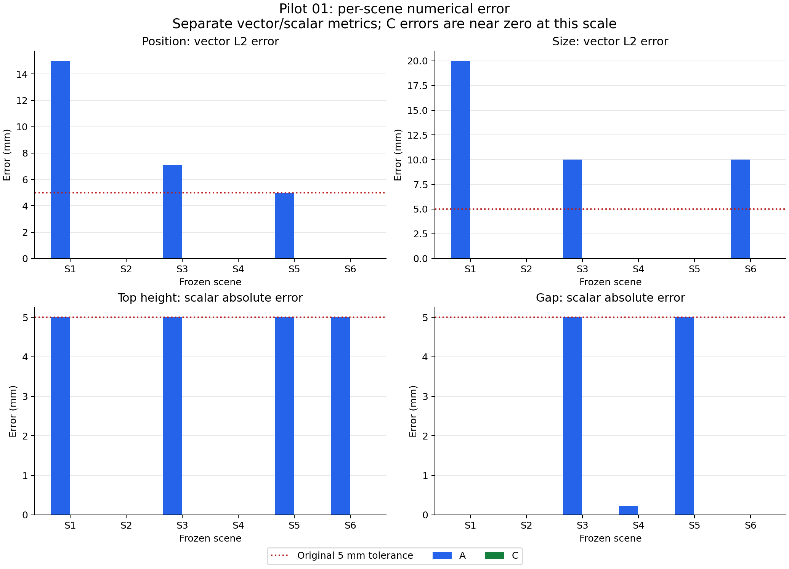
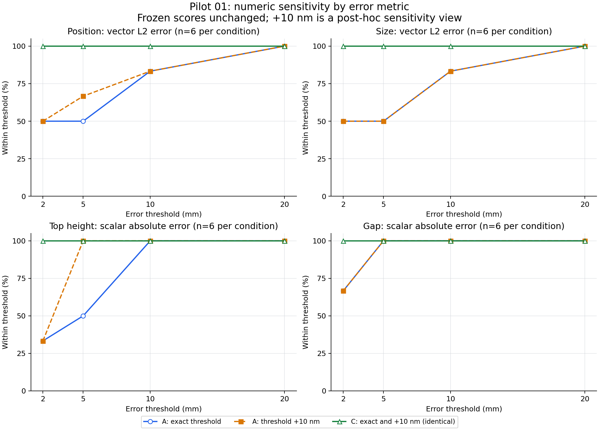

# Pilot 01 离线分析（源提交 b103ee5）

本目录只读取旧结果，真实生成请求为 **0**。旧 ledger、原始响应和评分均未改写。
原始理解正确数保留为 **A 45/54，C 54/54**；规划几何合法率为 A 6/6、C 6/6。

## 题型与场景

“直接数值读取”按所需答案操作分类：位置和尺寸可直接由 C 的几何字段读取；A 仍需从 RGB 估计。这不是对模型内部推理过程的观察。顶面高度和物体间隙属于几何计算；关系和指定姿态容纳属于判断。

| 操作类别 | A 原始 | C 原始 | 计分单位 |
| --- | --- | --- | --- |
| 关系 / 容纳判断 | 30/30 | 30/30 | 判断题 |
| 直接数值读取（位置 / 尺寸） | 6/12 | 12/12 | 向量答案 |
| 几何计算（顶高 / 间隙） | 9/12 | 12/12 | 标量答案 |
| 任务规划 | 6/6 | 6/6 | 完整规划几何合法性 |

| 题型 | A 原始 | C 原始 | 误差定义 |
| --- | --- | --- | --- |
| relation | 18/18 | 18/18 | 分类完全匹配 |
| fit | 12/12 | 12/12 | 分类完全匹配 |
| position | 3/6 | 6/6 | position_vector_L2_m |
| size | 3/6 | 6/6 | size_vector_L2_m |
| height | 3/6 | 6/6 | height_scalar_absolute_m |
| gap | 6/6 | 6/6 | gap_scalar_absolute_m |

[逐题误差](question_errors.csv)、[按操作类别](operation_accuracy.csv)、[按场景及类别](scene_operation_accuracy.csv)、[按场景及题型](scene_type_errors.csv)保留向量分量、L2 误差或标量误差。没有把位置、尺寸、顶面高度、间隙混成一个数值精度。



| 场景 | A 原始 | C 原始 | A +10 nm 敏感性 |
| --- | --- | --- | --- |
| lab_s1_relations | 6/9 | 9/9 | 7/9 |
| lab_s2_occlusion | 9/9 | 9/9 | 9/9 |
| lab_s3_narrow_container | 6/9 | 9/9 | 7/9 |
| lab_s4_rotated_fit | 9/9 | 9/9 | 9/9 |
| lab_s5_placement | 7/9 | 9/9 | 9/9 |
| lab_s6_held_object_detour | 8/9 | 9/9 | 8/9 |

## 浮点敏感性（分析视图，不替换评分）

四个失败项的误差仅高于 5 mm 约 2–4 nm。统一采用 **10 nm（1e-8 m）** 的比较余量，它覆盖这四项的纳米级边界偏差，且比原 5 mm 阈值小 500,000 倍。余量对所有数值题、A/C 条件和阈值一视同仁；不四舍五入答案或 GT，不改变类别判断。这是观察数据后指定的数值敏感性分析，不是预注册评分，也不是普遍适用的模拟器误差上界。

在原 5 mm 阈值加统一余量后，独立敏感性视图为 **A 49/54，C 54/54**。原始 A 45/54 仍是冻结结果。

| 场景 | 题目 | 误差 (mm) | 超出 5 mm (nm) |
| --- | --- | --- | --- |
| lab_s1_relations | top_height | 5.000003725290 | 3.725290 |
| lab_s3_narrow_container | top_height | 5.000002086163 | 2.086163 |
| lab_s5_placement | position | 5.000002980235 | 2.980235 |
| lab_s5_placement | top_height | 5.000003725290 | 3.725290 |

[阈值曲线表](threshold_curves.csv)列出 2/5/10/20 mm，分别报告位置 L2、尺寸 L2、高度绝对误差和间隙绝对误差，每种指标每条件 n=6。严格阈值和 +10 nm 结果同时保存；类别判断未被加入数值误差曲线的分母。



## 理解请求的 token、缓存与耗时

全部六对有效理解请求均来自 **180 秒、四 worker** 阶段。90 秒串行阶段仅有 S2 A 理解请求超时，客户端等待 90.097 秒，token usage 未知，没有有效 A/C 对。因此不能用本数据估计并发或截止时间变更的因果效应，也没有将超时当零 token。

S2 C 的 cached_input_tokens=7,040（input_tokens=12,298，约 57.25%）；其余有效理解请求缓存命中为 0。排除任一成员命中缓存的整个配对后剩 5 对，排除场景为 S2。缓存排除是一项描述性分层，不是随机对照。

### 全部六对

| 指标（每请求均值） | A | C | 配对 C−A 均值 |
| --- | --- | --- | --- |
| input_tokens | 11926.000 | 12531.000 | 605.000 |
| reasoning_output_tokens | 2237.333 | 6.167 | -2231.167 |
| other_output_tokens | 258.167 | 256.667 | -1.500 |
| client_wall_latency_s | 124.860 | 29.453 | -95.407 |

### 排除缓存命中配对，五对

| 指标（每请求均值） | A | C | 配对 C−A 均值 |
| --- | --- | --- | --- |
| input_tokens | 11929.000 | 12577.600 | 648.600 |
| reasoning_output_tokens | 2313.000 | 7.400 | -2305.600 |
| other_output_tokens | 258.000 | 256.600 | -1.400 |
| client_wall_latency_s | 128.044 | 30.098 | -97.946 |

[全部六对详情](understanding_pairs.csv)、[逐请求 token/cache/时间](understanding_requests.csv)、[各阶段请求计数](phase_counts.csv)和 [JSON 描述统计](token_descriptive_statistics.json)提供均值、中位数和范围。

reasoning output 是报告的 output_tokens 的子集；其余输出=output−reasoning，缓存输入是 input 的子集。token 数是服务端报告的使用量，不代表精确内部计算量；0 reasoning tokens 不证明没有内部推理。客户端耗时包含传输、排队、并发资源竞争、服务与后处理等，不是纯模型计算时间。bridge native latency 也不能当作纯计算时间。单个请求/条件/场景，没有重复测量，只有探索性描述统计。

## 规划

[planning_results.csv](planning_results.csv)单独列出 12 份冻结规划结果及原约束评分，全部合法；这不证明最优路径或所有空间任务已解决。S4 规定目标姿态，不能视作自主朝向规划能力。原图与独立几何视图的回放、路径长度和余量见同一交付中的规划回放目录。

## 复现

```bash
python3 experiments/spatial_input_eval_v0/lab/analyze_pilot01.py
```

该脚本不导入 adapter 或批次控制器，不执行 next/wave，不写旧 ledger。source_manifest.json 保存所读源文件 SHA256，并在输出完成后再次验证源文件未改变。

绘图使用独立 matplotlib 3.10.7 环境，PNG/SVG/PDF 从 CSV 生成；复现命令和输入校验和见 [plot_manifest.json](plot_manifest.json)。主分析不需要额外 Python 依赖。
